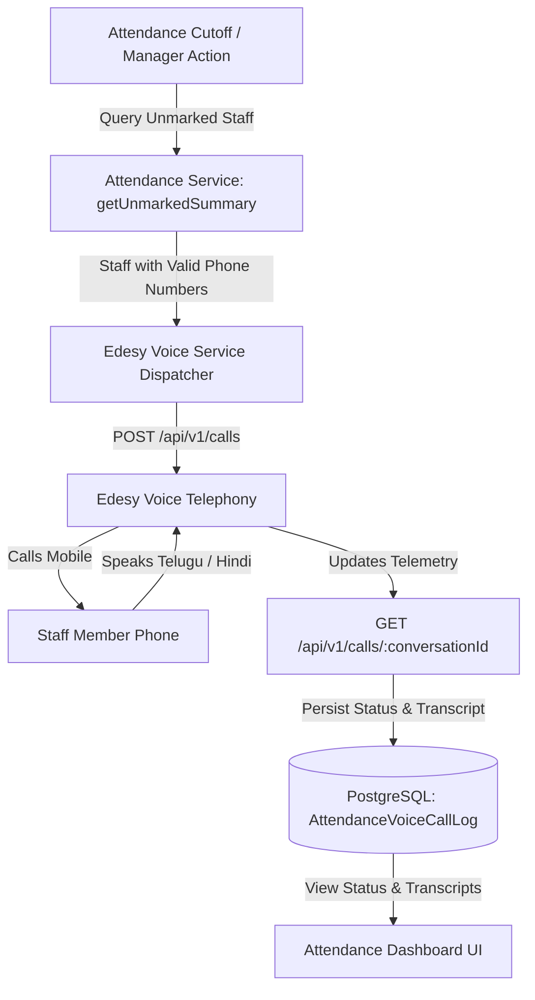

# Edesy Voice Agent Integration Guide

## 1. Executive Summary

This document specifies the integration of the **Edesy Conversational Voice AI Platform** into the Poultry Farm Management System (PoultryOps). The voice agent automates telephone calls to workers and employees who have not clocked in their shift attendance by the designated cutoff time.

The voice agent conducts natural, interactive two-way telephone conversations over standard cellular networks in regional Indian languages (**Telugu**, **Hindi**, and **English**), reminds staff to clock in, answers questions, checks if they require assistance or are taking leave, and logs transcripts and call outcomes directly into the database.

---

## 2. Platform Architecture & Verified Agents

### A. Core Platform
* **Platform Base URL:** `https://voice-agent.edesy.in/api/v1`
* **Underlying Engine:** Multimodal Google Gemini Live (`gemini-3.1-flash-live-preview` / `gemini-2.5-flash`)
* **Telephony Backbone:** Low-latency cellular carrier trunking supporting Indian numbers (`+91`)
* **Voice Activity & Latency:** Real-time conversational turn-taking with ambient noise filtering and interruption handling.

### B. Pre-Configured Agents

| Language | Agent ID | Agent Name | Opening Greeting |
| :--- | :--- | :--- | :--- |
| **Telugu (తెలుగు)** | `55427` | Attendance Reminder | *"హలో! PoultryOps యాప్ లో మీ అటెండెన్స్ మార్క్ చేయడం మర్చిపోకండి."* |
| **Hindi (हिंदी)** | `55446` | Attendance Reminder - Hindi | *"नमस्ते! कृपया PoultryOps ऐप में अपनी अटेंडेंस मार्क करना न भूलें।"* |
| **English** | `55408` | Demo: Customer Support - English | *"Hello! Please remember to mark your attendance in the PoultryOps app."* |

> [!NOTE]
> Agent `55427` (Telugu) also includes `hindi` in `additionalLanguages`, allowing it to dynamically switch to Hindi if the recipient answers in Hindi.

---

## 3. API Specification

All requests must include the Bearer authentication token in the request header.

### A. Place an Outbound Call
* **Endpoint:** `POST https://voice-agent.edesy.in/api/v1/calls`
* **Headers:**
  ```http
  Authorization: Bearer <EDESY_VOICE_API_KEY>
  Content-Type: application/json
  Idempotency-Key: <unique-string-identifier>
  ```
* **Request Payload:**
  ```json
  {
    "agentId": 55427,
    "phoneNumber": "+91XXXXXXXXXX"
  }
  ```
* **Success Response (`200 OK`):**
  ```json
  {
    "success": true,
    "data": {
      "conversationId": "39de74836fd92120",
      "callSid": "7f55f6ac-46aa-49c0-9004-eabb29a9f5b6",
      "status": "success"
    }
  }
  ```

---

### B. Retrieve Call Details & Transcript
* **Endpoint:** `GET https://voice-agent.edesy.in/api/v1/calls/:conversationId`
* **Headers:**
  ```http
  Authorization: Bearer <EDESY_VOICE_API_KEY>
  ```
* **Response Payload (`200 OK`):**
  ```json
  {
    "success": true,
    "data": {
      "conversationId": "39de74836fd92120",
      "callSid": "7f55f6ac-46aa-49c0-9004-eabb29a9f5b6",
      "agentId": 55427,
      "agentName": "Attendance Reminder",
      "phoneNumber": "+91XXXXXXXXXX",
      "status": "completed",
      "duration": 25,
      "disposition": "QUALIFIED",
      "summary": "The user confirmed they understood the reminder about marking attendance in the PoultryOps app.",
      "recordingUrl": null,
      "startTime": "2026-10-14T13:33:21.362Z",
      "endTime": "2026-10-14T13:33:54.075Z",
      "transcript": [
        {
          "role": "agent",
          "text": "హలో! PoultryOps యాప్ లో మీ అటెండెన్స్ మార్క్ చేయడం మర్చిపోకండి.",
          "timestamp": "2026-10-14T13:33:34.000Z"
        },
        {
          "role": "user",
          "text": "ఓకే, సరే.",
          "timestamp": "2026-10-14T13:33:38.000Z"
        }
      ],
      "fullText": "Agent: హలో! PoultryOps యాప్ లో మీ అటెండెన్స్ మార్క్ చేయడం మర్చిపోకండి.\nUser: ఓకే, సరే."
    }
  }
  ```

---

### C. List Historical Calls
* **Endpoint:** `GET https://voice-agent.edesy.in/api/v1/calls`
* **Query Parameters:** `?limit=50&offset=0`
* **Response:** Returns an array of recent calls with timestamps, durations, and call statuses.

---

### D. Agent Management
* **List All Available Agents:**
  ```http
  GET https://voice-agent.edesy.in/api/v1/agents
  ```
* **Create a New Agent:**
  ```http
  POST https://voice-agent.edesy.in/api/v1/agents
  Content-Type: application/json

  {
    "name": "Attendance Reminder - Hindi",
    "language": "hindi",
    "greetingMessage": "नमस्ते! कृपया PoultryOps ऐप में अपनी अटेंडेंस मार्क करना न भूलें।",
    "prompt": "## Role\nआप PoultryOps ऐप में यूज़र्स को अटेंडेंस मार्क करने की याद दिलाने वाले एक दोस्ताना वॉयस असिस्टेंट हैं।"
  }
  ```

---

## 4. End-to-End System Workflow



---

## 5. Website Implementation Plan

### A. Environment Configuration (`server/.env`)
Add placeholder variables to `.env.example` and `.env`:
```env
# Edesy Voice Agent Telephony
EDESY_VOICE_API_URL=https://voice-agent.edesy.in/api/v1/calls
EDESY_VOICE_API_KEY=your_edesy_api_key_here
EDESY_VOICE_AGENT_TELUGU_ID=55427
EDESY_VOICE_AGENT_HINDI_ID=55446
EDESY_VOICE_AGENT_ENGLISH_ID=55408
```

---

### B. Database Schema (`server/prisma/schema.prisma`)
Add a new model to track outbound reminder calls:

```prisma
enum VoiceCallStatus {
  DIALING
  CONNECTED
  COMPLETED
  NOT_CONNECTED
  FAILED
}

model AttendanceVoiceCallLog {
  id             String          @id @default(uuid()) @db.Uuid
  conversationId String          @unique
  callSid        String?
  farmId         String          @db.Uuid
  date           DateTime        @db.Date
  shift          Shift
  
  employeeId     String?         @db.Uuid
  workerId       String?         @db.Uuid
  personName     String
  phoneNumber    String
  language       String          @default("telugu")
  
  status         VoiceCallStatus @default(DIALING)
  durationSec    Int             @default(0)
  disposition    String?
  summary        String?         @db.Text
  recordingUrl   String?
  fullTranscript String?         @db.Text
  
  dispatchedById String?         @db.Uuid
  createdAt      DateTime        @default(now())
  updatedAt      DateTime        @updatedAt

  farm           Farm            @relation(fields: [farmId], references: [id])
  employee       Employee?       @relation(fields: [employeeId], references: [id])
  worker         Worker?         @relation(fields: [workerId], references: [id])
  dispatchedBy   User?           @relation(fields: [dispatchedById], references: [id])

  @@index([farmId, date, shift])
  @@map("attendance_voice_call_logs")
}
```

---

### C. Backend Service (`server/src/modules/attendance/voice-reminder.service.ts`)
1. **`dispatchReminderCalls`**:
   - Queries `getUnmarkedSummary(...)`.
   - Filters out staff without phone numbers or already called in the last 60 minutes.
   - Dispatches calls via `POST https://voice-agent.edesy.in/api/v1/calls`.
   - Records `AttendanceVoiceCallLog` entries in `DIALING` state.
2. **`syncCallStatus(conversationId)`**:
   - Queries `GET https://voice-agent.edesy.in/api/v1/calls/:conversationId`.
   - Updates status, duration, summary, and transcript upon completion.

---

### D. Frontend Dashboard Integration (`client/src/features/attendance`)
1. **Command Bar Action**:
   - Add a button **"AI Voice Reminder"** next to *"Mark Absent"*.
2. **Modal Preview (`VoiceReminderDialog.tsx`)**:
   - Previews unmarked employees and workers.
   - Allows choosing target language (**Telugu**, **Hindi**, or **English**).
   - "Dispatch Calls" button.
3. **Call History & Transcript Drawer**:
   - Shows real-time badge (`Dialing`, `Completed`, `Busy`).
   - Click any record to view the turn-by-turn regional transcript and AI summary.

---

## 6. Verified Test Transcripts

### Telugu Call (Agent `55427`)
```
Agent: హలో! PoultryOps యాప్ లో మీ అటెండెన్స్ మార్క్ చేయడం మర్చిపోకండి.
User:  ఓకే, సరే.
Agent: అలాగే! మీరు అటెండెన్స్ మార్క్ చేశారా, లేక యాప్ లో ఏమైనా సహాయం కావాలా?
User:  ఆహా ఏం వద్దు బానే ఉంది.
Agent: సరే, చాలా సంతోషం. మీ సమయానికి ధన్యవాదాలు, అటెండెన్స్ మార్క్ చేయడం మర్చిపోకండి! ఉంటాను!
```

### Hindi Call (Agent `55446`)
```
Agent: नमस्ते! कृपया PoultryOps ऐप में अपनी अटेंडेंस मार्क करना न भूलें।
User:  Ok.
Agent: ओके! क्या आपने अपनी अटेंडेंस मार्क कर दी है?
User:  Hello?
Agent: माफ़ करना, मुझे आपकी आवाज़ ठीक से सुनाई नहीं दी। क्या आप फिर से कहेंगे?
```

---

## 7. Security & Compliance Checklist
- [x] All API keys must be kept in `.env` and never committed to source control.
- [x] Phone numbers are formatted strictly in international E.164 (`+91XXXXXXXXXX`).
- [x] Calls include unique `Idempotency-Key` headers to prevent accidental duplicate dialing.
- [x] Telephony carrier dispositions (`BUSY`, `NO_ANSWER`, `USER_BUSY`) are gracefully handled and stored.
